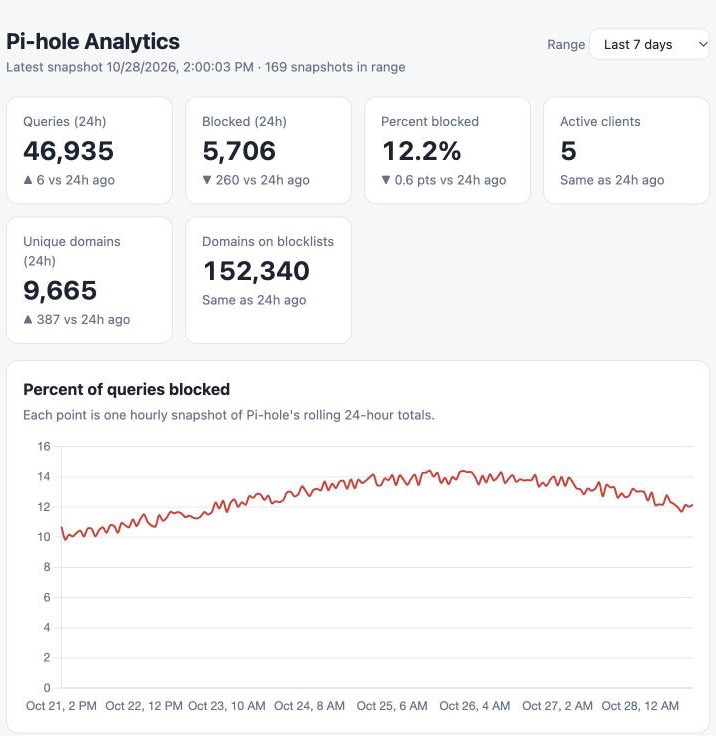
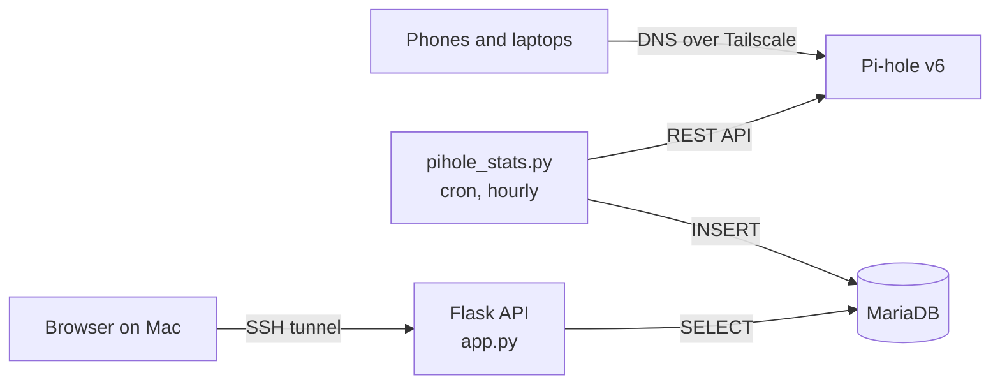

# Pi-hole + Tailscale DNS Analytics

[](https://github.com/tbrowan/pihole-tailcale-dns-analytics/actions/workflows/tests.yml)

A self-hosted analytics pipeline for my home network's DNS. A Raspberry Pi 3 B+ runs
[Pi-hole](https://pi-hole.net/) as the ad-blocking DNS server for all my devices over
[Tailscale](https://tailscale.com/). A Python collector records Pi-hole's statistics
every hour into MariaDB, and a Flask + Chart.js dashboard shows trends over time:
query volume, block rate, and which ad and tracking domains show up most persistently.


<sub>Screenshot uses generated sample data; real browsing data is never published.</sub>

## Architecture



Everything runs on one Raspberry Pi 3 B+ (1 GB RAM) alongside Pi-hole itself.

| Part | What it does |
|------|--------------|
| `pihole_stats.py` | Logs into the Pi-hole v6 REST API, reads summary stats and the top 10 blocked domains, saves a snapshot, and always logs out so it doesn't use up Pi-hole's session slots. |
| `schema.sql` | Two tables: `snapshots` (one row per hour) and `top_blocked` (one-to-many on `snapshot_id`). |
| `dashboard/app.py` | Flask JSON API: `/api/latest`, `/api/history?days=N`, `/api/top-blocked?days=N`. Also serves the front end. |
| `dashboard/client/` | Static HTML/CSS/JS front end using Chart.js. No build step. |
| `dashboard/pihole-dashboard.service` | systemd user service that starts the dashboard at boot and restarts it on failure. |

## Design decisions

**Getting the statistics right.** Each Pi-hole reading is a *rolling 24-hour total*, not
the queries from that hour. Adding hourly snapshots together would count the same
queries up to 24 times, so the dashboard never does that. Instead it:
- charts each snapshot as its own point,
- compares today's 24-hour window with the window exactly one day earlier (the snapshot
  closest to 24h back, since cron drifts by a few seconds), and
- ranks blocked domains by *how many hourly snapshots* they appear in, which measures
  how persistent they are without double-counting hits.

**Security**
- The dashboard's database user has only `SELECT` and `INSERT`; the dashboard itself is
  read-only.
- All SQL uses parameterized queries, and the `?days=` parameter is validated and
  limited to 1–90.
- Flask binds to `127.0.0.1` only, so nothing is exposed to the network. I view it
  through an SSH tunnel over Tailscale.
- Domain names come from DNS traffic, which other people control, so the front end
  inserts them with `textContent`, never `innerHTML`. That prevents cross-site
  scripting (XSS).
- Secrets live only in a gitignored `.env` file on the Pi.

**Built for small hardware.** No heavy frameworks, no Node build step, one pinned CDN
library. The Pi still has to serve DNS quickly for every device.

**Reliability.** systemd restarts the dashboard if it crashes. The page shows a warning
banner if the newest snapshot is more than 2 hours old, so a broken cron job gets
noticed.

## Tech stack

Python 3.13 · Flask · MariaDB · Chart.js · HTML/CSS/JavaScript · Pi-hole v6 REST API ·
Tailscale · systemd · cron · GitHub Actions

## Project structure

```
pihole_stats.py              collector (cron)
schema.sql                   database and user setup
requirements.txt
dashboard/
  app.py                     Flask API
  test_app.py                tests (database mocked)
  pihole-dashboard.service   systemd user service
  client/
    index.html
    resources/styles/main.css
    resources/scripts/app.js
.github/workflows/tests.yml  CI
```

## Setup

On the Pi, in `~/pihole-stats`:

1. **Database:** change `CHANGE_ME` in `schema.sql`, then `sudo mariadb < schema.sql`.
2. **Python:** `python3 -m venv venv && venv/bin/pip install -r requirements.txt`
3. **Config:** create `.env` (never commit it):
   ```
   PIHOLE_URL=http://127.0.0.1
   PIHOLE_APP_PASSWORD=...   # Pi-hole Settings > Web interface / API > app password
   DB_HOST=localhost
   DB_USER=pistats
   DB_PASSWORD=...
   DB_NAME=pihole_stats
   ```
4. **Collector:** `crontab -e` and add
   ```
   0 * * * * $HOME/pihole-stats/venv/bin/python $HOME/pihole-stats/pihole_stats.py >> $HOME/pihole-stats/collector.log 2>&1
   ```
5. **Dashboard:** `loginctl enable-linger` once, then
   `systemctl --user enable --now ~/pihole-stats/dashboard/pihole-dashboard.service`

To view it from a laptop, run `ssh -f -N -L 5001:127.0.0.1:5000 pi` and open
<http://localhost:5001>. (macOS AirPlay already uses local port 5000.)

## Tests

```
venv/bin/python -m unittest dashboard/test_app.py -v
```

The tests use Flask's test client with the database query function mocked, so they run
anywhere, including GitHub Actions on every push.
